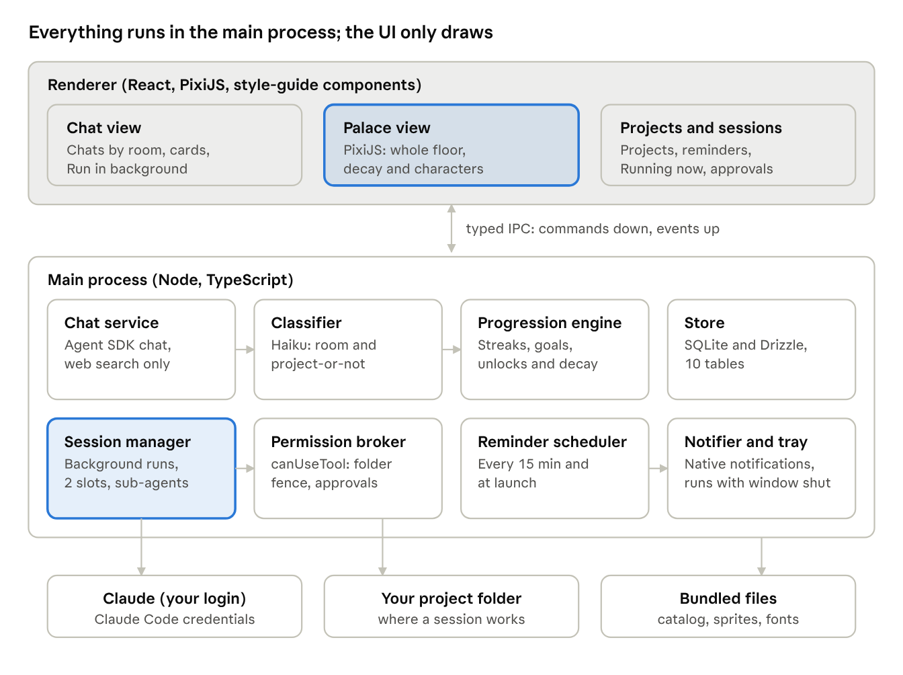
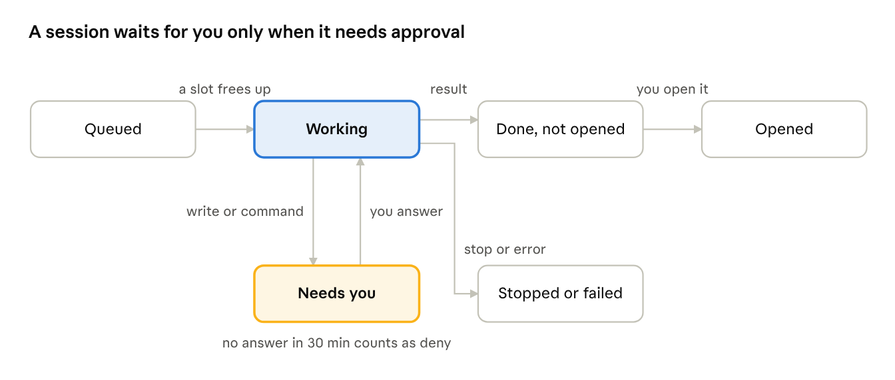
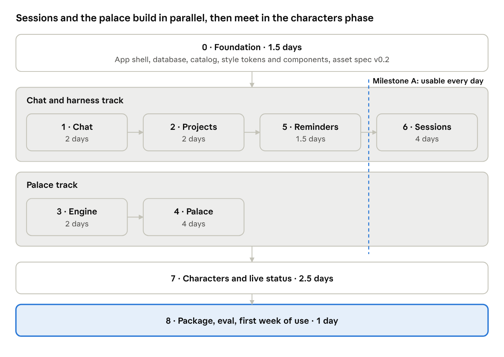

# Mind Palace — Implementation Plan v2

Nov 15, 2026 

## Summary

Mind Palace v2 is a local Electron chat app and agent harness on your own Claude login: chats land in one of four connected rooms, rooms furnish from streaks and finished goals, neglected rooms decay, and background sessions with sub-agents appear as characters working in their room. It replaces the first plan entirely. The build is about 20 focused days for one person, or about 14 for two working in parallel, with a usable daily build (Milestone A, everything except background sessions) after about 13 days, or 8 for two.

| Area | Decision |
| --- | --- |
| Users | Each person installs their own copy on their own Claude login. No accounts, no sync. |
| Shell and language | Electron, TypeScript everywhere. Tray icon, start at login, native notifications. |
| Model access | Claude Agent SDK on the local Claude Code login. Sonnet for chat and sessions, Haiku for classification and nudges. |
| Chat | Plain chat plus web search. |
| Background sessions | Started from a chat with Run in background. Each runs in a folder you pick, can spawn sub-agents, and asks you before any file write or command. At most 2 running at once. |
| Rooms | Coding room, Music studio, Art workshop, Mail room. One room per chat. Rooms are 8 x 8 tiles. |
| Palace | One connected floor: the four rooms in a 2 x 2 grid joined by 2-tile hallways. Click a room to zoom into it. |
| Unlocks | Per-room Fibonacci streak (2, 3, 5, 8, 13, 21, 34 days) with weekends as grace days. Per-room goal track (2, 3, 5, 8, 13 completed), at most one completion counted per day, a trophy per completion. |
| Projects | Model flags likely projects, you confirm. States: active, paused, done, dropped. Reminders after 3, 7 and 14 quiet days, then every 14. |
| Decay | Driven by the room's quietest open project: dust at 7 quiet weekdays, cobwebs at 14, mostly dark with occasional flicker at 21, fully dark at 30. Cleared by any activity on that project or by closing it. |
| Status in the palace | Nato = a session, robots = sub-agents. A dot over each character (room colour = working, gold = needs you, green = done and not opened). Details only on hover or tap. |
| Look | The Mind Palace visual style guide: walnut, parchment, brass, gold; Fraunces and Nunito Sans; hand-drawn art, never pixel art. |
| Storage | SQLite in the app's user-data folder. |

**What changed from v1:** the palace is one connected floor instead of a room switcher; decay and live characters are new; background sessions with sub-agents and approvals make it a real harness; the style guide replaces the placeholder purple theme; the asset spec moves from pixel rules to hand-drawn rules.

**Out of scope:** importing chats from other apps, multiple devices, mobile, proposing new rooms, doors that mean something, and scheduled or recurring sessions.

## Handoff to the build repo

The build lives in [Const-Tech-RD/mind-palace](https://github.com/Const-Tech-RD/mind-palace) (commit `0abc6cf`, Nov 15, 2026), where phases 0 to 3 and 5 are done. This plan's design wins; the repo's hand-drawn paintings set the look it is drawn in. Customization is the selling point, so rooms must be built from pieces you can place, move and remove, not finished paintings.

### Decisions for the repo

| Topic | Decision |
| --- | --- |
| The palace | This plan's connected palace: four 8 x 8 rooms in a 2 x 2 grid joined by 2-tile hallways, drawn as one PixiJS scene. It replaces the atrium hub (`PalaceHub.tsx`) and the whole-painting room view (`PalaceView.tsx`, `roomArt.ts`). |
| Look | Hand-drawn in the style of the repo's room paintings and the visual style guide. Rooms are assembled from sprites (an empty shell per tier, furniture, gear, decay overlays, characters) as asset spec v0.2 describes. |
| Customization | Unlocked furniture goes into the room's inventory and lands in its default catalog slot. You can move any item to any compatible slot, pick a variant, or hide it; gear is placed the same way. Your layout is stored per room and never reset by the engine. |
| Keep from the repo | Palace as the home screen with chat as a side panel, the Cmd+K command bar, the Claude Code import scripts, the eval tooling, and NOTES.md as the build log. |
| Existing paintings | Style reference for the artist, and the room's header picture until its sprites ship. Not the palace itself. |
| Before sprites exist | The renderer draws placeholder blocks from footprints and heights, as the mockups do, so code never waits on art. |

### Where to look

| Work | Start in | What changes |
| --- | --- | --- |
| Style guide | `src/renderer/src/styles.css` | Replace the purple theme with the guide's tokens, bundle the three fonts, build the component set. The guide itself says the purple theme is a skeleton to replace. |
| Palace renderer | `PalaceHub.tsx`, `PalaceView.tsx`, `roomArt.ts`, `src/shared/palace.ts` | A new PixiJS `PalaceCanvas`. Keep `buildPalace` as its view model and extend it with placements, decay level and characters. |
| Layout | `catalog/rules.json` (`layout.slots`), `src/shared/catalog/schema.ts` | Keep the 8 x 8 slot grid; add each room's offset in the palace, hallway tiles and doorways. Declare base and shared items (layer, footprint, height) in a new `catalog/items.json`, closing NOTES item 8. |
| Placement | `src/shared/engine/unlocks.ts`, `src/main/db/schema.ts` | The engine still decides what is unlocked. A new `placements` table stores where you put each item (room, item, slot, variant, hidden). No row means the catalog's default slot. |
| Decay | `src/shared/engine/roomState.ts` | Add `decayLevel` from the quietest active project's weekday count, pure and tested like the rest of the engine. |
| Background sessions | `src/main/chat/claude.ts` (the only module that talks to Claude) | Add a session runner beside the chat path: working folder, tools from gear, `canUseTool` into the consent ladder, sub-agents keyed by `parent_tool_use_id`. Chat stays web search only. |
| New tables | `src/main/db/schema.ts` plus a Drizzle migration | `sessions`, `agents`, `approvals`, `events`, `placements`. The ledger reads from `events`. |
| Characters | `PalaceHub.tsx` (Nato's walk), `src/renderer/src/assets/characters/` | Move Nato and the helper robot into the canvas: one Nato per running session, a robot per sub-agent, status dots, hover tooltips. |

### Fixes found in the repo

- The sign-in screen should say `claude auth login --claudeai`, not the older command.
- Clear inherited `ANTHROPIC_*` and `CLAUDE_CODE_*` variables before starting the SDK, so launching from a Claude Code terminal can't borrow that session's login.
- Drop `goal_completions.counted`; the engine already ignores it.
- A plain chat turn costs about 38,000 input tokens, mostly the SDK's own system prompt and tool definitions. Show it in the ledger, and consider a slimmer system prompt for plain chat.
- Recommended answer to the repo's timezone question: store each message's local day when it is written, so a timezone change never rewrites past room days.

### Reference material

The handoff bundle (`mind-palace-handoff.zip`) goes into the repo's `docs/` folder:

- `docs/HANDOFF.md`: this section on its own, for the coding agent.
- `docs/plan-v2.md`: this plan as Markdown.
- `docs/mockups/`: all 14 mockup screens as plain HTML; start at `index.html`. Room art, Nato and robots there are code-drawn placeholders.
- `docs/asset-spec.md`: v0.2, the hand-drawn sprite rules.
- `docs/research-borrow.md`: what to borrow from StarNet, Pixel Agents and OpenClaw Office, with file paths.

The [design canvas](https://claude.ai/artifact/6zZUcQy2xjMcFzX74h2gza), the [research notes](https://claude.ai/artifact/MA2mr6WDqHLT6QKRGbrtYH) and the [mission briefing](https://claude.ai/artifact/6tJTVucdUM3WHx1LEiN9fq) are the live versions; their links only open for people they are shared with.

## Architecture

All logic lives in the Electron main process; the React renderer only draws and sends commands over typed IPC. That keeps the Claude credentials, the database and running sessions out of the UI, and lets sessions and reminders keep going with the window closed.

The progression engine is pure functions over the event history, so unlocks and decay are always recomputed, never stored. The session manager streams SDK messages into the store and emits events the palace turns into characters and dots.

| Concern | Choice |
| --- | --- |
| Build | electron-vite, one repo: `main/`, `preload/`, `renderer/`, `shared/` |
| UI | React, the style-guide component set, Zustand for UI state |
| Palace | PixiJS: one scene for the whole floor, smooth scaling for hand-drawn art |
| Model | `@anthropic-ai/claude-agent-sdk`; Sonnet for chat and sessions, Haiku for classifier and nudges |
| Chat tools | Web search only |
| Session tools | Read, search, web search and fetch, sub-agents; writes and commands through approval |
| Database | better-sqlite3 with Drizzle ORM |
| Packaging | electron-builder for Windows (NSIS) and macOS (dmg), unsigned for internal use |
| Tests | Vitest for logic, Playwright for screenshots and the smoke run |

## Data model

Ten tables hold everything; unlocks and decay are never stored, only derived from the event tables. Rooms are not a table: they come from the bundled catalog files, keyed by `room_id`.

| Table | Key fields | Notes |
| --- | --- | --- |
| `chats` | `id`, `title`, `room_id`, `room_source` (`model` or `user`), `sdk_session_id`, `created_at`, `last_message_at` | `room_id` is null until classified. `room_source = user` means you moved it; the classifier never overrides that. |
| `messages` | `id`, `chat_id`, `role`, `content`, `created_at`, `tokens_in`, `tokens_out` | The local day of a user message feeds the streak. |
| `projects` | `id`, `title`, `room_id`, `state` (`suggested`, `active`, `paused`, `done`, `dropped`), `next_step`, `last_activity_at`, `snoozed_until`, `created_at`, `closed_at` | `last_activity_at` drives both reminders and decay. |
| `project_chats` | `project_id`, `chat_id` | A project spans several chats, all in its room. |
| `goal_completions` | `id`, `project_id`, `room_id`, `local_day`, `counted` | `counted = false` when a second completion lands on the same day. |
| `reminders` | `id`, `project_id`, `due_at`, `sent_at`, `message`, `action` (`opened`, `done`, `snoozed`, `paused`, `dropped`, `ignored`) | `action` is the main success measure. |
| `sessions` | `id`, `chat_id`, `room_id`, `project_id`, `title`, `cwd`, `state`, `sdk_session_id`, `started_at`, `ended_at`, `opened_at`, `cost_tokens`, `result_summary` | One background run. `opened_at` null + `state = done` is the green "done, not opened" dot. |
| `agents` | `id`, `session_id`, `parent_tool_use_id`, `kind` (`main` or `sub`), `label`, `state`, `started_at`, `ended_at` | One row per agent in a session: the main agent plus each sub-agent, keyed by the SDK's `parent_tool_use_id`. |
| `approvals` | `id`, `session_id`, `agent_id`, `tool_name`, `tool_input`, `requested_at`, `decided_at`, `decision` (`allow`, `deny`, `timeout`) | Every permission request a session raised, and your answer. |
| `settings` | `key`, `value` | Timezone, notifications on or off, model choices, session limits. |

Timestamps are stored in UTC; streaks, decay and the one-per-day goal rule use the local calendar day from the `settings` timezone.

## Core rules

Five rule sets drive the palace: classify each chat into one room, count streak days per room, count goals at most once a day, nudge quiet projects, and let rooms decay around neglected projects. All of them live in the progression engine as pure functions of the event history and `rules.json`.

### Classification

1. After the second user message, Haiku gets the chat so far plus each room's `belongs`, `not_here` and `examples` text, and returns `{room_id, confidence, is_project, project_title, next_step}` as JSON.
2. Below 0.6 confidence the chat goes to the Mail room.
3. After 30 quiet minutes the chat is classified once more. The room only changes if the answer is confident and you haven't moved the chat yourself.
4. If the chat looks like a project, the classifier also gets the titles of your open projects in that room. A match shows "Link this chat to X?"; no match shows "Track it?".

### Streaks

- A room day is a local calendar day with at least one user message in a chat of that room.
- Walking back from today, a weekday without a room day ends the run. Saturday and Sunday never end it, and count only if you chatted.
- Today without a chat yet does not end the run.
- Each milestone unlocks once per room, permanently. A broken streak resets the counter, never the furniture.

### Goals

- Marking a project done writes a `goal_completions` row; a second completion in the same room on the same day is stored with `counted = false`.
- Milestones 2, 3, 5, 8 and 13 unlock base furniture; every counted completion adds a trophy, up to five. Reopening a project removes its completion and the unlocks recompute.

### Projects and reminders

- Activity is a new message in any chat linked to the project, or a session run for it.
- Reminders are due at 3, 7 and 14 days after the last activity, then every 14 days. Snooze moves the next one; paused, done and dropped projects get none.
- The scheduler runs every 15 minutes and at launch; a reminder missed while the machine was off fires once at launch. At most two reminder notifications a day; the rest wait in the in-app inbox.
- Each reminder's text comes from Haiku over the project's chats: the project name plus one small next step.

### Decay

- A room's decay level comes from its quietest open (active) project: the number of weekdays since that project's `last_activity_at`. Weekends don't count, matching the streak.
- Levels: 0 to 6 days clean, 7 dusty, 14 cobwebs, 21 mostly dark with occasional flicker, 30 fully dark.
- Activity on the project, or marking it done, paused or dropped, recomputes the level at once, and the room shows a short "lights back on" moment.
- A room with no open projects never decays, however long you stay away. Furniture is never removed.

## Background sessions and sub-agents

A background session is an Agent SDK run you start from a chat; it works in a folder you choose, may spawn sub-agents, and stops to ask you before it writes a file or runs a command. Sub-agents follow the same states and show as robots beside the session's Nato.

Only the gold "Needs you" state waits on you; everything else moves on its own, and a finished session stays green in the palace until you open it.

| Topic | Rule |
| --- | --- |
| Starting one | Run in background in the chat composer. You pick the folder (remembered per project). The session takes the chat's room and project, and a short title from the model. |
| Allowed without asking | Read, search and list files inside the folder, web search, web fetch, and spawning sub-agents. |
| Asks first | Any file write or edit, and any command. The request goes through the SDK's `canUseTool` callback to an approval card, a notification and the gold dot. Anything outside the folder is denied without asking. |
| No answer | After 30 minutes a request counts as denied, and the session is told so it can carry on or finish. |
| Limits | At most 2 sessions running, others queued. Each session has a turn cap and a token cap from `settings`. Sub-agents can't spawn their own sub-agents. |
| The tree | Every SDK message from a sub-agent carries the `parent_tool_use_id` of the call that spawned it; that id keys the `agents` table and the Running now panel. |
| Finishing | The result summary is posted back into the originating chat as a card, with a notification. Opening it sets `opened_at` and Nato sits down. |
| Stopping | Stop aborts the run and kills its whole process tree, including any sub-agents. |
| App closed mid-run | Running sessions are marked stopped ("app closed") and offer Resume, which continues from the SDK session id. |

## The palace

The palace is one PixiJS scene of the whole floor: four 8 x 8 rooms in a 2 x 2 grid, joined by 2-tile hallways, 18 x 18 tiles in all. Rooms keep the 8 x 8 slot layout from `rules.json`, so the renderer only offsets each room; nothing about furniture placement changes.

| Part | How it works |
| --- | --- |
| Layout | Coding room back, Art workshop right, Music studio left, Mail room front. Outer back walls full height; every wall that faces a hallway is low with a doorway, so front rooms never hide back ones. A small lobby where the hallways cross. |
| Draw order | Floors and outer walls, then each room back to front, with its low walls drawn after its furniture. Depth sort inside a room by footprint, as in the asset spec. |
| Camera | Fits the whole palace by default. Click or tap a room to zoom into it; Esc or the back button returns. Scroll to zoom, drag to pan. |
| Room labels | Small UI pills floating above each room (badge dot + name), never painted into the art. |
| Room light | One glow per room in its accent colour, centred on its light source (monitor, sconce, easel lamp, desk lamp). Everything else falls to warm shadow. |
| Decay | Overlay sprites for dust and cobwebs, a desaturate filter from 7 days, and a darkness layer over the room from 21. At 21 the light flickers on for a moment at random intervals of 20 to 60 seconds; at 30 it stays off. |
| Characters | Nato sits at the room's desk for a running session; each sub-agent is a robot at one of three helper spots per room. More than three sub-agents shows a "+N" tag. A finished, unopened session keeps Nato standing until you open it. |
| Status dots | A dot over each character: room colour with a pulse = working, gold with a pulse = needs you, green = done and not opened. |
| Details | Hovering a room (or tapping it once on a touch screen) shows its tooltips and outlines its floor. Clicking a tooltip opens that session or project. |
| Accessibility | A plain list view of the same information (rooms, sessions, decay) for screen readers and for anyone who turns off animation. Animations respect the OS reduced-motion setting. |

### Style guide in the app

- The guide's CSS tokens go into `renderer/styles/tokens.css` as-is; the old purple theme is deleted.
- Fraunces, Nunito Sans and JetBrains Mono ship inside the app as woff2 files, so it works offline.
- One component set built from the guide: buttons (primary, secondary, ghost, danger), parchment and panel cards, chips, room badges, inputs, chat bubbles, progress bars. Every screen uses only these.
- One gold primary action per view. Room accents only in small details: badge dots, the selected-chat bar, goal bars, room glow.
- Anything coloured on parchment uses the `-deep` variants, so every screen passes WCAG AA.

## Phases and tasks

The build is nine phases, about 20 focused days for one person or 14 for two splitting the tracks after the foundation. Milestone A, after phases 0 to 5, is the tracker and the connected palace without background sessions. Each task below fits one Claude Code session and ends with a check you can run.

Phase 7 waits for both tracks: characters need the palace renderer and the session events. Until then the palace runs on fixture data.

### 0 · Foundation (1.5 days)

- [ ] Scaffold electron-vite with `main/`, `preload/`, `renderer/`, `shared/`, plus a typed IPC contract in `shared/ipc.ts`. Done when the renderer calls a typed `ping`.
- [ ] SQLite with Drizzle: all ten tables and migrations at start. Done when a fresh launch creates the database.
- [ ] Catalog loader for `rules.json` and `rooms/*.json`, validated with zod. Done when a broken file names its path and field.
- [ ] Tray icon, start at login, closing the window keeps the app running.
- [ ] Style tokens from the guide, bundled fonts, and the component set (buttons, cards, chips, badges, inputs, bubbles, progress bars) on one test page. Done when the test page matches the guide and passes an automated contrast check.
- [ ] Asset spec v0.2 agreed with the artist (see Risks).

### 1 · Chat (2 days)

- [ ] Login check, with a "run `claude auth login --claudeai`" screen when there are no Claude Code credentials.
- [ ] Chat service on the Agent SDK with web search only, streaming, Stop. Done when a search answer shows its sources.
- [ ] Persist chats and messages; resume a chat by SDK session id after restart.
- [ ] Chat screen per the mockup: chat list grouped by room, room badge, Move to room.

### 2 · Rooms and projects (2 days)

- [ ] Classifier on Haiku, Mail room below 0.6, re-check after 30 quiet minutes. Done when it meets the eval bar.
- [ ] Track it? and Link to project cards, with the duplicate check.
- [ ] Projects panel: states, Done, Snooze, Pause, Drop, Reopen.

### 3 · Progression engine (2 days)

- [ ] `computeRoomState(roomId, events, rules, today)`: streak, goals, unlocked items with slots, next unlock, decay level. Pure, no database.
- [ ] Unit tests for every rule in Core rules, decay included.
- [ ] Unlock and clean-up events from yesterday's state against today's, for the toasts.

### 4 · Connected palace (4 days)

- [ ] Asset loader for the manifest, with placeholder art drawn from footprints when a sprite is missing.
- [ ] One-room renderer: shell tier, slots, depth sort, room glow. Done when every slot renders right.
- [ ] Whole palace: four rooms, hallways, low walls with doorways, draw order across rooms, room label pills.
- [ ] Camera: fit, zoom into a room, pan, back.
- [ ] Decay visuals: dust, cobwebs, desaturate, darkness, random flicker every 20 to 60 seconds, the "lights back on" moment.
- [ ] Hover or tap a room for its tooltips; plain list view; reduced-motion support.

* [ ] Event throttling (from OpenClaw Office): session start, session end and errors render at once; everything else is batched once per animation frame; past 500 queued events, trim to the newest 200 with a warning.

- [ ] Room editor and inventory: each room's unlocked items in a drawer; drag an item to any compatible slot (same layer, footprint fits), pick a variant, or hide it. Store it in `placements`; the engine never moves or removes what you placed. Done when a customized room survives a restart and a new unlock lands in its default slot without disturbing the rest.

### 5 · Reminders (1.5 days)

- [ ] Scheduler with the cadence, snooze and two-a-day cap; nudge text from Haiku.
- [ ] Native notifications and the in-app inbox; every outcome logged to `reminders.action`.

### 6 · Background sessions (4 days)

- [ ] Session manager: queue with two slots, start from a chat with a chosen folder, turn and token caps, Stop that kills the process tree, Resume after the app closes.
- [ ] Permission broker on `canUseTool`: folder fence, approval cards, notifications, 30-minute timeout, `approvals` log.
- [ ] Agent tree from `parent_tool_use_id`, stored in `agents`.
- [ ] Running now panel and the result card posted back into the chat.

* [ ] Prompt-injection guard: the session system prompt treats anything read from files or the web as data, never instructions; a test task with a hostile page must not trigger a write or command without approval.

- [ ] Consent ladder (from StarNet's `permissions.js`), in fixed order: a hard deny list nothing can override; full access if switched on; grants you gave for this session or permanently; then read-only offline calls auto-allow while changes ask. Approval cards get "Allow for this session" beside Approve. Unattended runs deny instead of waiting: silence is not consent.
- [ ] Standing grants panel (from `permgrants.js`): every permanent approval with when it was given and a revoke button. Only writing files inside the session's folder can be granted ahead of time; commands, sending and spending never can.
- [ ] Emergency stop (from `halt.js`): one tray action aborts every running session and records why each ended (stopped, halted, faulted). It must never throw.
- [ ] Event contract (from `shared/events.js` and Pixel Agents' event set): one shared, schema-checked list of event types that sessions emit and the UI consumes: tool start and end, sub-agent start and end, turn end (with an awaiting-input flag), permission request and answer, session start and end, checkpoint created and restored, memory proposed, budget threshold. Additive only: never rename or remove an event or field.

### 7 · Characters and live status (2.5 days)

- [ ] Nato and robot sprites placed at the desk and helper spots, with "+N" past three.
- [ ] Status dots from session and agent states; done-not-opened keeps Nato standing.
- [ ] Tooltips for sessions and approvals; clicking one opens the session.

* [ ] Status rules (from Pixel Agents): a session is active, or inactive in exactly one of three ways: done, waiting for input, or waiting on a permission. The permission dot stays until answered; characters stay seated while waiting and only wander when done, so a still, seated character always means it needs you.

### 8 · Package, eval, first week of use (1 day)

- [ ] electron-builder installers for Windows and macOS, unsigned.
- [ ] Classifier eval on each person's test set; screenshot tests approved.
- [ ] Each of you uses it for a week; review the three numbers in Testing.

## Testing and evals

Four things get automated checks: the progression engine, the classifier, the session manager and the palace's look in each state. Each runs in CI on every change and locally with one command.

| What | How | Pass bar |
| --- | --- | --- |
| Progression engine | Table-driven Vitest cases: dated events in, room state out. Covers weekends, a missed weekday, the full 34-day ladder, two goals in a day, a reopened goal, a moved chat, a timezone change, and each decay level including recovery. Every function takes `today`, never the system clock. | All green |
| Classifier | `npm run eval` over each person's `eval/<name>.jsonl` (first two user messages, expected room, expected is-project). Prints accuracy and the misses. Run after every change to a room's text. | 85% room accuracy, project precision above 70% |
| Session manager | A fake SDK stream that replays recorded message sequences: a plain run, a run with two sub-agents, a permission request approved, one denied, one timed out, a stop mid-run, a crash. Checks the `sessions`, `agents` and `approvals` rows and the events sent to the UI. | All green |
| Palace states | Playwright screenshots of fixed fixtures: empty palace, fully furnished, each decay level, a busy room with three sub-agents, a waiting approval. Compared against approved images. | No unexpected diffs |
| Smoke run | Playwright on the packaged app: send a chat, see it classified, start a background session, approve a request, see the robot and the dot, mark a project done, see the goal bar move. | Passes on Windows and macOS |

After the first real week, review three numbers: the share of reminders that end in done, snoozed, paused or dropped; how many chats you moved by hand; and how many approval requests you denied.

## Risks and open questions

The two biggest risks are the art and the harness: the progression needs furniture as separate sprites while the existing art is whole-room illustrations, and background sessions can change files on your machine. Both have to be settled before their phases start.

| Risk | Effect | Mitigation |
| --- | --- | --- |
| Art format | Unlocking furniture needs each item as its own sprite on the shared grid. The existing room art (`room_medina`, `room_mailroom` and others) is one illustration per room. | Decided: separate hand-drawn sprites in the style of the existing paintings (see Handoff). Until they ship, the renderer draws placeholder blocks from footprints. |
| Asset spec conflicts with the style guide | The current asset spec demands pixel-art rules (no anti-aliasing, nearest-neighbour scaling, 32 colours). The guide forbids pixel art. | Done: asset spec v0.2 keeps the grid, anchors, layers and manifest and switches to soft-edged hand-drawn art exported at 2x with smooth scaling. |
| Sessions changing files | A background session could edit or delete things in its folder. | It only runs in the folder you pick; every write and command needs your approval; nothing outside that folder; a full log in `approvals`. |
| Usage limits | Sessions and sub-agents use far more of your plan than chat does. | At most 2 sessions at once, a turn and token cap per session, tokens shown on each session card. |
| Orphaned sub-agents | There are reports of sub-agents continuing after their parent is stopped. | Stop kills the whole process tree; the session manager checks for leftovers at launch. |
| Agent SDK auth rules | Anthropic's rules on subscription use from the SDK changed several times in 2026. | Keep model access behind one module so switching to an API key is a config change. |
| Windows notification buttons | Electron's action buttons only work on macOS. | Click-to-open on Windows; toast XML actions later if needed. |

**Open questions**

- [ ] Furniture art: decided. Separate sprites on the shared grid, drawn in the style of the existing room paintings, because customization needs pieces you can move.
- [ ] Room colours: the existing Music studio art is lit orange while its accent is pink, and the Mail room art is warm cream while its accent is cool grey. Change the accents or repaint the light?
- [ ] Should a session be allowed to run commands at all in the first version, or only read, search and write files? Sandboxed commands, under Later, are the long-term answer.
- [ ] Should a weekend chat count toward the streak, or only not break it? This plan counts it.
- [ ] Does a project ever move rooms when its chats drift? This plan keeps it in its first room.

## Next phases: from app to proper harness

After phase 8, six phases make the harness something you can trust with real work, in this order: traces, cost ledger and run comparison, memory, undo, gear, earned autonomy. Together they are about 14 focused days. Most of the safety design comes from StarNet's open-source code ([research notes](https://claude.ai/artifact/MA2mr6WDqHLT6QKRGbrtYH)).

### 9 · Run traces (2 days)

A timeline of what each session did, so you can see why a run went wrong or took too long.

- [ ] `events` table: one row per SDK message, tool call, sub-agent start and end, approval and error, with timestamps and token counts.
- [ ] Trace view on the session card: a scrollable timeline, grouped by agent, with tool inputs and outputs expandable.
- [ ] Done when a finished session's full trace can be read after an app restart.

* [ ] The `events` table stores exactly the event contract from phase 6, so traces, the ledger and the palace all read one stream.

### 10 · Cost ledger and run comparison (2 days)

How much of your plan's usage each session, room and project used, built on the trace data.

- [ ] Token totals per session, per room and per project, for today, this week and this month.
- [ ] Tokens shown live on the session card, and the per-session caps tuned from real numbers.
- [ ] Done when the ledger totals match the sum of the trace rows.

* [ ] Append-only ledger (from StarNet's `ledger.js`): one immutable line per finished session with tokens in and out, turns, tool calls and duration. A session that ended without usage data stays visible as "unsettled" instead of counting as zero.
* [ ] Plan usage: your 5-hour and 7-day plan windows as a percentage, beside the token counts. First check whether the Agent SDK reports them; if not, Pixel Agents' status-line script is the fallback.
* [ ] Compare runs: pick two sessions and see them side by side: tokens, turns, time, tool calls, approvals, files changed and the result. A "Run again with…" button repeats a task with a different model, prompt or gear on a throwaway copy of the folder (from the phase 12 snapshot), so you can compare two ways of doing the same task.

### 11 · Memory (2.5 days)

Sessions start knowing the project: stack, decisions, things ruled out, and the next step.

- [ ] One memory file per project and one per room, as Markdown in the app's data folder, editable by you.
- [ ] Sessions read the project and room files at start, and propose additions at the end, which you accept or reject.
- [ ] The project's next step in the tracker comes from its memory file, so the two never disagree.
- [ ] Done when a second session on a project uses a decision made in the first without being told.

### 12 · Undo (2 days)

Roll back everything a session changed with one button.

- [ ] Snapshot the folder before a session's first write into a shadow git repo (from StarNet's \`checkpoint-store.js\`): its git directory lives in the app's data folder, outside your folder, so the session can't read or rewrite its own history and your own repo is never touched. Line-ending conversion off for byte-exact restores; a failed snapshot never crashes the run.
- [ ] Undo this session on the result card, with a list of the files it will restore.
- [ ] Done when undo after a 15-file session leaves the folder byte-identical to before.

### 13 · Gear (3.5 days)

Objects placed in a room grant sessions in that room their tools, built the way StarNet's `capability/resolve.js` does it.

- [ ] Grant registry as data: each gear type maps to grants of `{tool, scope: read | write | execute, asksFirst, network}`. Editing gear never means editing code.
- [ ] `resolveTools(session, palace)`: a pure function run fresh before every model call, so placing or removing gear changes a session's reach on its next turn. Its result feeds the consent ladder.
- [ ] A desk in every room grants the always-on basics (reading its own status, updating its project's next step), so no room can strand a session.
- [ ] Edit room mode: the gear drawer, drag onto gear slots, and an inspector per item (what it grants, allow / ask / off, the filing cabinet's folder). Gear lights up and the character walks to it when its tool runs.

### 14 · Earned autonomy (2 days)

A good track record lets the app offer to loosen one permission at a time, never silently (from StarNet's `trust.js`).

- [ ] Track record per room: finished sessions, approvals you granted, denials, undos and failed runs.
- [ ] Offer, don't grant: after enough clean runs, a card offers one step up (for example, "Allow file edits in the Coding room without asking?"). Accept, decline, or ignore; a declined offer isn't repeated.
- [ ] Demotion: a run of denials, undos or failures lowers the level again, with a notice.
- [ ] Hard ceiling: commands, sending and spending are never offered. It is based on your session record, never on chat streaks.

**Later:** a benchmark suite (a fixed set of tasks re-run automatically and scored after any change to prompts, models or gear, building on Compare runs), steering a running session, and sandboxed commands (below).

**Reference for later:** the remaining ideas from Pixel Agents and OpenClaw Office (context gauge, silhouettes through walls, sub-agent vs teammate seating, gathering for collaboration, positions from the session id, room-day heatmap, mock mode) stay in the [research notes](https://claude.ai/artifact/MA2mr6WDqHLT6QKRGbrtYH) until a phase needs them.

## Later: sandboxed sessions

Not in this build. Once background sessions are stable, run a session's commands inside a container instead of directly on your machine, so a bad command can only damage a throwaway copy. The idea comes from Hermes Agent, which runs sub-agents in isolated environments with local, Docker, SSH and other backends ([Hermes Agent](https://hermes-agent.nousresearch.com/)).

| Topic | Sketch |
| --- | --- |
| What runs inside | Commands only (the terminal). Reading, searching and the web stay on the host as now. |
| Backend | Docker first: one container per session, with the session's folder mounted. Other backends only if needed. |
| Files | The folder is mounted read-write, or copied in and changes shown as a diff you accept at the end. The diff option is safer but slower to build. |
| Network | Off inside the container by default; turned on per session when a task needs it. |
| Approvals | Commands in the sandbox could run without asking, since they can't touch anything else. File changes still go through approval or the end-of-run diff. |
| Cost to add | Roughly 3 to 4 days: container lifecycle, the mount or diff, a Docker check at startup, and a clear message when Docker isn't installed. |
| Why wait | It adds a Docker dependency and setup on Windows and macOS, and the folder fence plus approvals is enough for the first version. |

This is also the long-term answer to the open question about whether sessions should run commands at all.

## Reference files

These are the inputs the build reads; they go into the repo under `catalog/`, `assets/` and `docs/` in phase 0.

| File | Status | Repo path |
| --- | --- | --- |
| `rules.json` | Current (streak, weekend grace, goals, base ladder, 8 x 8 slot layout) | `catalog/rules.json` |
| `rooms/coding.json`, `music.json`, `art.json`, `mailroom.json` | Current | `catalog/rooms/` |
| Mind Palace visual style guide | Current | `docs/style-guide.md` |
| `asset-spec.md` | Needs v0.2 (hand-drawn rules, see Risks) | `docs/asset-spec.md` |
| [Mockup canvas](https://claude.ai/artifact/6zZUcQy2xjMcFzX74h2gza) | Current reference for every screen; room art there is placeholder | Linked, not copied |
| [Implementation plan v1](https://claude.ai/artifact/R6B45k4q1ekYqeiuENEYHY) | Replaced by this document | Archive |

Agent SDK behaviour this plan relies on: sub-agent messages carry a `parent_tool_use_id`, tool approvals go through a `canUseTool` callback, and each run takes a working directory (`cwd`). Check these against the SDK version you install ([TypeScript reference](https://docs.claude.com/en/api/agent-sdk/typescript)).
